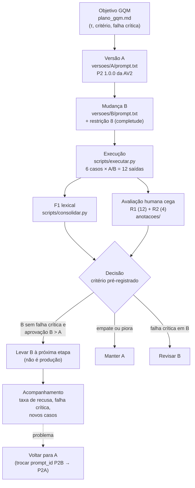

# Ciclo de vida e versionamento mínimo (Parte F)

## Fluxo



## Cadeia rastreável

`caso (casos/casos.yaml: CTxx)` → `saída (saidas/<versão>/CTxx.json)` → `nota (anotacoes/R1.csv, R2.csv,
consenso.csv via chave_cegamento.csv)` → `decisão (resultados/tabela_12.csv, resumo.json)` → `versão
(versoes/<versão>/manifesto.yaml + execucao.json)`.

Cada arquivo de saída carrega `versao`, `caso_id`, `configuracao` (prompt_id, sha256 do prompt, modelo, parâmetros,
fluxo), `commit`, data, `consulta_busca` (consulta reescrita), `chunks` (contexto efetivamente usado, com texto),
`saida_bruta` (texto exato devolvido pela API), `saida_final`, `model_version`, tokens e `trace_url` do Langfuse.

## Como as versões ficam preservadas

| Item | A | B |
|---|---|---|
| Pasta | `atividade3/versoes/A/` | `atividade3/versoes/B/` |
| Prompt | `prompt.txt` (id P2A, 1.0.0) | `prompt.txt` (id P2B, 1.1.0) |
| Única mudança | — | restrição 8 (`diff versoes/A/prompt.txt versoes/B/prompt.txt`) |
| Manifesto | `manifesto.yaml` (declarado) + `execucao.json` (gerado na execução) | idem |
| Saídas | `atividade3/saidas/A/` | `atividade3/saidas/B/` |

Recomendação de commits (o histórico do git serve de prova do pré-registro):
1. `plano GQM, casos, rubrica e versões A/B` — **antes** de executar;
2. `saídas brutas A/B` — logo após `executar.py`;
3. `anotações R1/R2` — após a avaliação, sem editar depois;
4. `consenso e consolidação` — por fim. Tag opcional: `av3-A`, `av3-B`.

## Reconstrução de uma saída

```bash
git checkout <commit de execucao.json>
python -m atividade3.scripts.executar --versao A   # em uma pasta de saídas vazia
```

Reproduzível: código, prompt (conferir `sha256`), corpus, casos, parâmetros, consulta e chunks usados.
**Não congelável:** a revisão do modelo hospedado no Groq (`openai/gpt-oss-120b`) não pode ser fixada pela API; o
`model_version` e a data ficam registrados, mas o provedor pode trocar pesos ou infraestrutura. Com temperatura 0 a
saída ainda pode variar entre execuções (não determinismo de inferência em lote), e a consulta reescrita é gerada
pelo LLM, então a recuperação também pode mudar. Por isso a reconstrução é verificada comparando a nova saída com a
guardada, e não presumida.

## Acompanhamento e retorno a A

- Sinais a acompanhar após a próxima etapa: taxa de falha crítica (alvo 0), taxa de recusa em perguntas com
  evidência, tamanho médio da resposta (B pede mais conteúdo), aprovação humana em amostra semanal de casos novos.
- Voltar a A: trocar `VERSOES`/`prompt_id` para `P2A` (o arquivo de A nunca é editado); a mudança é de uma linha e
  não exige reindexação nem novo modelo.
