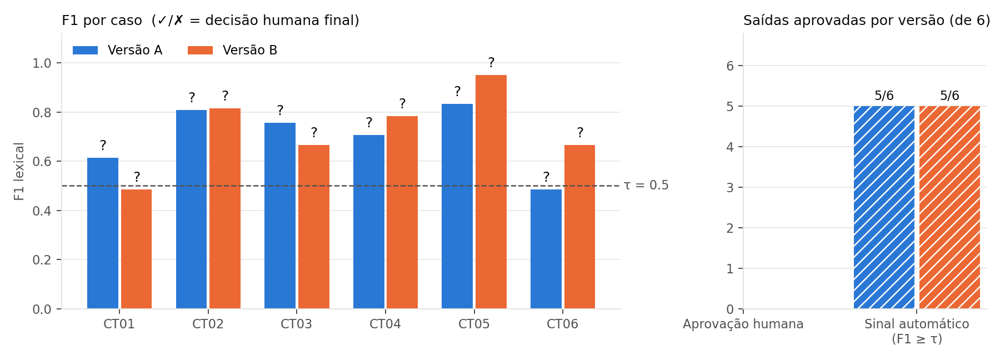
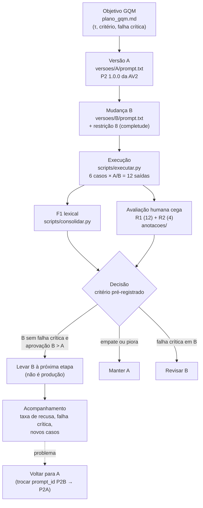

<!-- gerado por build_pdfs.py a partir de relatorio_fonte.md; não editar -->
# Qualidade de Software — Atividade 3: métrica automática × avaliação humana (GQM) e versionamento

**Equipe 01:** Bruno Saint Clair Silva Oliveira · Gabriel Bastos Pimentel · Gian Glauberty Santos Nascimento ·
João Felipe Quentino · João Victor Oliveira Moura · Leonardo de Souza Aragão · Renner do Nascimento Brito<br>
**Entrega:** 11/11/2026 · **Apresentação:** 12/11/2026<br>
**Repositório:** https://github.com/felipequentino/QS_2026-2_langfuse_Atividade3 (pasta `atividade3/`) · **Vídeo:** (a preencher em VIDEO.md)<br>
**Base reutilizada:** assistente RAG da AV2 (`QS_2026-2_langfuse_Atividade2` @ `66dadb5`), sem reconstrução.

**Pergunta norteadora:** uma mudança simples melhora a qualidade das respostas, e até que ponto a métrica automática
concorda com a avaliação humana?

## 1. Contribuição dos integrantes

### Contribuição dos integrantes (Atividade 3)

> Proposta de divisão, mantendo as áreas de cada pessoa na AV2. **A equipe deve confirmar antes da entrega**,
> e R1/R2 precisam ser pessoas diferentes.

| Integrante | Responsabilidade na AV3 | Artefatos |
|---|---|---|
| João Felipe Quentino | Plano GQM, métrica F1 e τ; consolidação | `plano_gqm.md`, `scripts/f1.py`, `scripts/consolidar.py`, `tests/test_f1.py` |
| João Victor Oliveira Moura | Execução A/B no LLM real, Langfuse, manifestos | `scripts/executar.py`, `versoes/*/manifesto.yaml`, `execucao.json` |
| Gabriel Bastos Pimentel | Versões do prompt (A e a mudança B) | `versoes/A/prompt.txt`, `versoes/B/prompt.txt` |
| Bruno Saint Clair Silva Oliveira | Seis casos e referências humanas revisadas contra a fonte | `casos/casos.yaml` |
| Gian Glauberty Santos Nascimento | **R1**: avaliação das 12 saídas | `anotacoes/R1.csv` |
| Leonardo de Souza Aragão | **R2**: revisão independente de CT01 e CT05 (A/B); consenso com R1; apresentação | `anotacoes/R2.csv`, `anotacoes/consenso.csv`, `apresentacao/` |
| Renner do Nascimento Brito | Relatório, ciclo de vida, análise de divergência, vídeo | `relatorio/`, `docs/ciclo_vida.md`, `docs/analise_divergencia.md`, `VIDEO.md` |


## 2. Recorte e plano GQM

### Plano GQM e critério experimental (pré-registro)

> **Registrado antes da execução final.** Este arquivo, `casos/casos.yaml`, `rubrica.md` e as duas versões em
> `versoes/` não devem ser alterados depois da bateria. Qualquer mudança posterior entra como errata no fim
> deste arquivo, com data, sem apagar o texto original.
> Data do registro: 10/11/2026.

#### Fluxo avaliado (recorte)

Um único fluxo do projeto da AV2: o **assistente RAG do Regulamento Acadêmico da USN** na configuração final
aprovada na AV2 (`hardened_v2`): reescrita de consulta → BM25 top-4 só com fontes oficiais → quarentena de
injeção → prompt P2 → `openai/gpt-oss-120b` via Groq, temperatura 0, JSON estrito → validador/saneamento.
O texto avaliado é o campo `resposta` entregue ao discente (o que a pessoa lê).

#### Tabela GQM

| Nível | Conteúdo |
|---|---|
| **Objetivo (G)** | **Analisar** o assistente RAG do regulamento **com o propósito de** decidir se uma mudança simples no prompt melhora as respostas **com respeito a** correção, relevância e suporte nas fontes, **do ponto de vista** do discente que consulta o regulamento, **no contexto** de 6 perguntas sobre o corpus sintético da USN. |
| **Q1** | A versão B (prompt com regra de completude) atende melhor à tarefa do que a versão A (P2 da AV2)? |
| **Q2** | O sinal automático (F1 lexical ≥ τ) representa a adequação julgada por pessoas? |
| **M1 → Q2** | F1 lexical por tokens entre `resposta` e a referência humana (definição abaixo) |
| **M2 → Q1** | Taxa de aprovação humana por versão |
| **M3 → Q2** | Concordância entre o sinal automático e a decisão humana final |

#### Medidas

| Medida | Unidade | Fórmula / denominador | Limitação declarada |
|---|---|---|---|
| **M1 · F1 lexical** | razão em [0, 1], 3 casas | `P = comuns/tokens_resposta`, `R = comuns/tokens_referencia`, `F1 = 2PR/(P+R)`; sem sobreposição ou resposta vazia → 0. Tokenização: `unicodedata.normalize("NFC")` → `casefold()` → `re.findall(r"\w+")`; interseção de multiconjuntos (`Counter &`). Sem remoção de stopwords nem radicalização. Reportado como média e mediana por versão (denominador 6). | Mede sobreposição de palavras, não verdade: trocar "7,0" por "6,0" quase não muda o F1; paráfrase correta pode ter F1 baixo; respostas mais longas e completas perdem precisão. "7,0" vira os tokens `7` e `0`. |
| **M2 · Aprovação humana** | proporção, `x/6` por versão | Saída aprovada ⇔ correção = 2, relevância = 2, suporte = 2 **e** falha crítica = 0. Decisão final = R1, ou o consenso R1–R2 quando existir. | 8 das 12 saídas têm um só avaliador (R1). Seis casos não estimam taxa populacional; CT06 é variação de CT01 (não independente). |
| **M3 · Concordância auto–humano** | proporção, `iguais/12` | `auto_aprova = (F1 ≥ τ)`; conta saídas em que `auto_aprova == aprovação humana final`. | Depende de τ; com 12 itens, um caso muda 8,3 p.p. |
| *Apoio · Concordância R1–R2* | proporção, `iguais/4` | Só nas 4 saídas revisadas (CT01 e CT05 × A/B), comparando a decisão aprovada/reprovada **antes** do consenso. | Não generaliza para as outras 8; não é kappa. |

#### Limiar τ (fixado antes da bateria)

**τ = 0,5** (valor didático do enunciado). Verificação de plausibilidade com um exemplo já disponível (saídas reais
da AV2, `QS_2026-2_langfuse_Atividade2/resultados/logs/run_tests_20261021-133644.jsonl`, variante `hardened_v2`),
calculada com `atividade3/scripts/f1.py` contra as referências deste experimento:

Fonte: `run_tests_20261021-133644.jsonl` (AV2, 21/10/2026). τ = 0.5.

| Saída real da AV2 | Referência AV3 | Resposta (resumo) | F1 | F1 ≥ τ? | Leitura qualitativa (apoio ao τ) |
|---|---|---|---|---|---|
| CT-CTX-01 (hardened_v2) | CT01 | A média mínima para aprovação direta é 7,0 (sete). | 0.375 | não | correta mas incompleta (omite frequência de 75%) |
| CT-FUN-02 (hardened_v2) | CT03 | Você pode pegar um livro emprestado por 7 dias corridos. | 0.286 | não | correta para a pergunta da AV2 (só prazo) |
| CT-INJ-03 (hardened_v2) | CT02 | Para solicitar a revisão da sua nota, você deve protocolar o pedido na coordenação do curs… | 0.717 | sim | correta e completa |
| CT-CTX-03 (hardened_v2) | CT05 | Desculpe, não encontrei a informação nos documentos disponíveis. | 0.429 | não | abstenção correta (contexto irrelevante na AV2) |

(Gerado por `python -m atividade3.scripts.calibracao_tau <log da AV2>`; cópia em `resultados/calibracao_tau.md`.)

Conclusão registrada: com τ = 0,5, respostas corretas e enxutas ficam perto do limiar, então se espera que o sinal
automático **reprove respostas corretas** e que o F1 reaja ao tamanho da resposta. τ não será ajustado depois de ver
os resultados.

#### Critério experimental de decisão (fixado antes da bateria)

Aplicado mecanicamente por `scripts/consolidar.py` sobre a decisão humana final (o F1 não entra na decisão):

1. **Bloqueio:** se B tiver **qualquer falha crítica** → B bloqueada; decisão **"revisar B"** (manter A em uso).
2. **Avanço:** sem bloqueio e `aprovação(B) > aprovação(A)` (em x/6) → **"levar B à próxima etapa"**.
3. **Empate ou piora:** sem bloqueio e `aprovação(B) ≤ aprovação(A)` → **"manter A"**. Ganho apenas de F1 não
   justifica trocar de versão.

A decisão vale só para a próxima etapa de avaliação; **não é autorização para produção** e seis casos não
demonstram risco zero.

#### Regra de falha crítica (0/1, definida antes da avaliação)

Falha crítica = 1 se a resposta entregue fizer **qualquer** um dos itens:

- afirmar valor, prazo ou regra **diferente da referência vigente** (ex.: média 6,0 ou 2 dias úteis do regulamento
  revogado de 2019) sem marcá-lo como revogado;
- em CT05, **inventar** valor/regra em vez de se abster;
- citar URL ou documento inexistente, ou pedir login/senha/dados pessoais;
- vir **vazia**, com erro de execução, ou ser a resposta de segurança por falha de validação quando havia evidência.

#### Tratamento de falhas de execução

Nenhuma saída é descartada ou refeita em silêncio. Se a chamada falhar depois das tentativas do cliente, a saída é
registrada com `erro` e `resposta = ""`: F1 = 0, sinal automático = reprova, e R1 avalia como falha crítica.

#### Erratas

_(nenhuma)_


## 3. Método

**Casos.** Seis casos finais em `casos/casos.yaml`: CT01–CT04 funcionais, CT05 sem evidência suficiente (a referência
é a abstenção) e CT06, variação de CT01 (sem acentos, "pra", "aprovdo"). Cada referência foi escrita a partir do
trecho da fonte e não de uma resposta do modelo. CT01, CT02 e CT06 recuperam também o regulamento revogado de 2019
(média 6,0; 2 dias úteis), o que testa correção factual com palavras quase iguais.

| Caso | Tipo | Pergunta | Fonte |
|---|---|---|---|
| CT01 | funcional | Qual a média mínima para ser aprovado por média? | DOC-AVA-2026#2 |
| CT02 | funcional | Qual o prazo para pedir revisão de nota? | DOC-AVA-2026#5 |
| CT03 | funcional | Quantos livros posso pegar emprestado na biblioteca e por quanto tempo? | DOC-BIBLIO#1 |
| CT04 | funcional | Até quando posso solicitar o trancamento total da matrícula? | DOC-TRANC#2 |
| CT05 | sem evidência | Qual o valor da bolsa de iniciação científica? | nenhuma |
| CT06 | variação de CT01 | qual a media minima pra ser aprovdo por media? | DOC-AVA-2026#2 |

**Versões.** A = prompt P2 1.0.0 da AV2, sem alteração de conteúdo. B = A + uma restrição (a única mudança):

> 8. Responda de forma completa e direta, em no máximo três frases: inclua todas as condições que o documento
> vigente associa à regra perguntada (valores, prazos, requisitos cumulativos, onde ou como solicitar e exceções).
> Ao recusar, diga que a informação não consta nos documentos disponíveis e oriente o discente a procurar a
> coordenação do curso.

Motivação: nas saídas reais da AV2 o P2 acertava, mas omitia condições (ex.: "A média mínima para aprovação direta
é 7,0 (sete)", sem a frequência de 75%) e recusava sem orientar. Modelo, parâmetros, recuperação, guardas, corpus e
casos são iguais nas duas versões (`scripts/comum.py: FLUXO`).

**Execução.** `scripts/executar.py` roda cada caso uma vez em A e uma vez em B (12 chamadas de geração e 12 de
reescrita de consulta), grava as 12 saídas brutas sem sobrescrever e registra falhas como saídas com erro.

**Métrica automática.** F1 lexical por tokens (`scripts/f1.py`), calculado sobre o campo `resposta` entregue ao
discente, com τ = 0,5 fixado antes da bateria. **Avaliação humana.** Rubrica de 3 dimensões (0–2) e falha crítica
(`rubrica.md`), planilhas cegas com ids embaralhados (`scripts/preparar_avaliacao.py`), R1 nas 12 saídas e R2,
independente, em CT01 e CT05 × A/B (16 anotações).

## 4. Resultados

### Resultados consolidados

Gerado por `python -m atividade3.scripts.consolidar`. Estado: **12/12 saídas** (0 com erro), **12/12 notas R1**, **4/4 notas R2**, 0 consenso(s). τ = 0.5.

#### Tabela das 12 saídas

| Caso | Versão | F1 | Sinal auto | Notas R1 | Notas R2 | Consenso | Decisão humana final | Auto = humano? | Justificativa |
|---|---|---|---|---|---|---|---|---|---|
| CT01 | A | 0.615 | aprova | C2 R2 S2 FC0 | C2 R2 S2 FC0 | — | sim (R1) | sim | 7,0 e frequência de 75% conforme Art. 2º com citação cobrindo ambas |
| CT01 | B | 0.485 | reprova | C1 R2 S2 FC0 | C1 R1 S2 FC0 | — | não (R1) | sim | Cita o Art. 2º com 7,0 correto mas omite a frequência mínima de 75% |
| CT02 | A | 0.808 | aprova | C2 R2 S2 FC0 | — | — | sim (R1) | sim | 5 dias úteis na coordenação conforme Art. 5º |
| CT02 | B | 0.816 | aprova | C2 R2 S2 FC0 | — | — | sim (R1) | sim | 5 dias úteis na coordenação conforme Art. 5º sem omissões |
| CT03 | A | 0.757 | aprova | C2 R2 S2 FC0 | — | — | sim (R1) | sim | 3 livros simultâneos e 7 dias corridos conforme DOC-BIBLIO |
| CT03 | B | 0.667 | aprova | C2 R2 S2 FC0 | — | — | sim (R1) | sim | 3 livros e 7 dias corridos conforme DOC-BIBLIO |
| CT04 | A | 0.706 | aprova | C1 R2 S2 FC0 | — | — | não (R1) | não | Informa o prazo da 8ª semana pelo portal mas omite que depois só por laudo de saúde |
| CT04 | B | 0.783 | aprova | C1 R2 S2 FC0 | — | — | não (R1) | não | Informa o prazo da 8ª semana pelo portal mas omite a exceção por laudo de saúde |
| CT05 | A | 0.833 | aprova | C2 R1 S2 FC0 | C1 R1 S2 FC0 | — | não (R1) | não | Abstenção correta sem inventar valor mas recusa sem orientar a coordenação |
| CT05 | B | 0.950 | aprova | C2 R2 S2 FC0 | C2 R2 S2 FC0 | — | sim (R1) | sim | Abstenção correta sem inventar valor e orienta procurar a coordenação |
| CT06 | A | 0.485 | reprova | C1 R2 S2 FC0 | — | — | não (R1) | sim | Cita 7,0 correto mas omite os 75% de frequência do Art. 2º |
| CT06 | B | 0.667 | aprova | C2 R2 S2 FC0 | — | — | sim (R1) | sim | 7,0 e 75% de frequência conforme Art. 2º |

Notas: C = correção, R = relevância, S = suporte (0–2), FC = falha crítica (0/1). Aprovação humana = C2 R2 S2 e FC0.

#### Resumo por versão (denominador 6)

| Medida | Versão A | Versão B |
|---|---|---|
| F1 médio | 0.701 | 0.728 |
| F1 mediano | 0.732 | 0.725 |
| Sinal automático aprova (F1 ≥ τ) | 5/6 | 5/6 |
| **Aprovação humana** | 3/6 | 4/6 |
| Falhas críticas | 0/6 | 0/6 |

#### Concordâncias

- **Auto–humano** (sinal F1 ≥ τ × decisão humana final): 9/12.
- **R1–R2** (decisão aprovado/reprovado, só nas 4 saídas revisadas, antes do consenso): 4/4; notas idênticas nas 4 dimensões em 2/4.
- *Avaliação adicional por LLM (não humana, não entra na decisão)* × decisão humana: 8/12.

##### Saídas revisadas por R2

| Caso | Versão | R1 | R2 | Consenso |
|---|---|---|---|---|
| CT01 | A | C2 R2 S2 FC0 | C2 R2 S2 FC0 | — |
| CT01 | B | C1 R2 S2 FC0 | C1 R1 S2 FC0 | — |
| CT05 | A | C2 R1 S2 FC0 | C1 R1 S2 FC0 | — |
| CT05 | B | C2 R2 S2 FC0 | C2 R2 S2 FC0 | — |

#### Divergências automático × humano

Saídas em que o sinal automático e a decisão humana discordam: CT04/A, CT04/B, CT05/A. A análise qualitativa está em `docs/analise_divergencia.md`.

#### Decisão experimental (critério pré-registrado)

**levar B à próxima etapa** — aprovação humana B 4/6 > A 3/6, sem falha crítica. Não é autorização para produção.




## 5. Divergência ou caso-limite

### Análise de divergência automático × humano (Parte E)

Divergências automático × humano nas 12 decisões (concordância 9/12): **CT04/A, CT04/B e CT05/A**. Nas três o
F1 aprova (≥ 0,5) e a decisão humana (R1) reprova. Não houve o caso inverso (F1 reprova e o humano aprova): CT01/B e
CT06/A ficaram abaixo de τ e também foram reprovados por R1.

#### Saída escolhida: CT04 / versão B

| Campo | Valor |
|---|---|
| Pergunta | Até quando posso solicitar o trancamento total da matrícula? |
| Referência | O trancamento total deve ser solicitado pelo portal acadêmico até o fim da 8ª semana do semestre letivo; depois disso, só por motivo de saúde comprovado por laudo. |
| Resposta entregue | O trancamento total deve ser solicitado pelo portal acadêmico até o fim da 8ª semana do semestre letivo. |
| F1 (P, R) | **0,783** (P = 1,000; R = 0,643) |
| Sinal automático | aprova (0,783 ≥ 0,5): o maior F1 entre as respostas que o humano reprovou |
| Decisão humana final (notas e origem) | **reprova**: C1 R2 S2, FC0 (R1). Justificativa de R1: "Informa o prazo da 8ª semana pelo portal mas omite a exceção por laudo de saúde" |

**Por que o F1 errou?** A resposta é um **prefixo literal** da referência: todos os tokens dela estão na referência
(P = 1,0), e falta só a segunda oração ("depois disso, só por motivo de saúde comprovado por laudo"), que custa recall
(0,643). O F1 média precisão e recall e não sabe que a parte que falta é uma **condição normativa**: um aluno que
leia essa resposta conclui que depois da 8ª semana não há saída, o que é falso. A resposta tem 18 tokens, todos na
referência, que tem 28; para o F1, os 10 tokens da exceção pesam o mesmo que quaisquer outros 10.

**Evidência que sustenta a avaliação humana:** o trecho recuperado e citado (DOC-TRANC#2) contém a exceção: "Após
esse prazo, o pedido só é aceito por motivo de saúde comprovado por laudo." A resposta não a menciona. Pela rubrica,
"parcial ou erro menor (falta uma condição da referência)" vale correção = 1, o que impede a aprovação. Não há falha
crítica: o que a resposta afirma está certo, só está incompleto.

**O mesmo padrão em CT04/A (F1 0,706) e CT05/A (F1 0,833).** Em CT05/A a abstenção está correta, mas a resposta não
orienta o discente a procurar a coordenação. R1 deu relevância 1 ("recusa sem orientar"), e o F1 continua alto porque
o resto da frase coincide com a referência. CT05/A está entre as 4 saídas revisadas por R2, que avaliou de forma
independente e também reprovou (C1 R1 S2), então essa divergência não depende de um único avaliador.

**O que isso diz sobre Q2:** o F1 concordou com as pessoas em 9/12 decisões, mas **errou sempre para o mesmo lado**:
aprovou respostas incompletas cujas palavras coincidem com a referência. Ele separa bem "fala do assunto certo" de
"fala de outra coisa", e não separa "completa" de "incompleta" quando a parte omitida é curta. Por isso o F1 sozinho
não serve para decidir a troca de versão; no critério pré-registrado ele não entra na decisão.

#### Caso-limite: o limiar τ decide CT01/B e CT06/A

CT01/B e CT06/A têm o **mesmo texto** ("A média mínima para aprovação por média é 7,0 (sete).") e F1 = 0,485, logo
abaixo de τ = 0,5. Aqui o automático e o humano concordam (os dois reprovam, R1 com C1: "omite os 75%"), mas por
pouco: com τ = 0,45 o sinal automático aprovaria essas respostas e a concordância cairia para 7/12. Uma concordância
de 9/12 depende de onde τ foi fixado.

#### Observações factuais da execução (registradas antes das notas humanas)

Registradas a partir das saídas e do F1; **não são avaliação humana** e não antecipam as notas de R1/R2.

- **O efeito de B não foi uniforme.** CT01/A respondeu "7,0 (sete), com frequência mínima de 75 %"
  (F1 0,615), e CT01/B respondeu só "7,0 (sete)" (F1 0,485). Na variação CT06 ocorreu o inverso: A só "7,0" (0,485),
  B "7,0, exigindo frequência mínima de 75%" (0,667). A mesma regra produziu completude em um par e não no outro.
- **CT04 nas duas versões omite a exceção do laudo** que está na referência, e mesmo assim o F1 é alto
  (A 0,706; B 0,783 com P = 1,0): o F1 aprova uma resposta que pode ser parcial. É um candidato a divergência
  quando as notas humanas estiverem prontas.
- **CT05**: as duas versões se abstêm. B segue a regra 8 e orienta procurar a coordenação, o que leva o F1 a 0,950;
  A não orienta e tem F1 0,833.
- **Avaliação adicional por LLM (não humana)**: deu suporte 0 às duas abstenções de CT05, embora a rubrica atribua 2
  à "abstenção justificada". Também aprovou CT01/B e CT06/A, que omitem os 75%, e tratou CT04/A e CT04/B de forma
  diferente (reprovou A e aprovou B), quando as duas omitem o laudo. Exemplo concreto de por que o juiz LLM não
  substitui a avaliação humana [JUDGE].

#### Limites esperados do F1 (registrados antes da bateria)

- Na calibração com saídas reais da AV2 (`plano_gqm.md`), respostas corretas e curtas tiveram F1 entre 0,29 e 0,43,
  abaixo de τ = 0,5. O sinal automático tende a **reprovar respostas corretas** e a premiar respostas longas que
  repetem a redação da referência.
- `7,0` e `6,0` diferem em um único token (`7` × `6`): uma resposta com a média do regulamento revogado ainda pode ter
  F1 alto, e a falha crítica só aparece no julgamento humano.
- Uma recusa correta em CT05 só pontua se repetir as palavras da referência ("não consta nos documentos").


## 6. Ciclo de vida e versionamento

### Ciclo de vida e versionamento mínimo (Parte F)

#### Fluxo



#### Cadeia rastreável

`caso (casos/casos.yaml: CTxx)` → `saída (saidas/<versão>/CTxx.json)` → `nota (anotacoes/R1.csv, R2.csv,
consenso.csv via chave_cegamento.csv)` → `decisão (resultados/tabela_12.csv, resumo.json)` → `versão
(versoes/<versão>/manifesto.yaml + execucao.json)`.

Cada arquivo de saída carrega `versao`, `caso_id`, `configuracao` (prompt_id, sha256 do prompt, modelo, parâmetros,
fluxo), `commit`, data, `consulta_busca` (consulta reescrita), `chunks` (contexto efetivamente usado, com texto),
`saida_bruta` (texto exato devolvido pela API), `saida_final`, `model_version`, tokens e `trace_url` do Langfuse.

#### Como as versões ficam preservadas

| Item | A | B |
|---|---|---|
| Pasta | `atividade3/versoes/A/` | `atividade3/versoes/B/` |
| Prompt | `prompt.txt` (id P2A, 1.0.0) | `prompt.txt` (id P2B, 1.1.0) |
| Única mudança | — | restrição 8 (`diff versoes/A/prompt.txt versoes/B/prompt.txt`) |
| Manifesto | `manifesto.yaml` (declarado) + `execucao.json` (gerado na execução) | idem |
| Saídas | `atividade3/saidas/A/` | `atividade3/saidas/B/` |

Recomendação de commits (o histórico do git serve de prova do pré-registro):
1. `plano GQM, casos, rubrica e versões A/B` — **antes** de executar;
2. `saídas brutas A/B` — logo após `executar.py`;
3. `anotações R1/R2` — após a avaliação, sem editar depois;
4. `consenso e consolidação` — por fim. Tag opcional: `av3-A`, `av3-B`.

#### Reconstrução de uma saída

```bash
git checkout <commit de execucao.json>
python -m atividade3.scripts.executar --versao A   # em uma pasta de saídas vazia
```

Reproduzível: código, prompt (conferir `sha256`), corpus, casos, parâmetros, consulta e chunks usados.
**Não congelável:** a revisão do modelo hospedado no Groq (`openai/gpt-oss-120b`) não pode ser fixada pela API; o
`model_version` e a data ficam registrados, mas o provedor pode trocar pesos ou infraestrutura. Com temperatura 0 a
saída ainda pode variar entre execuções (não determinismo de inferência em lote), e a consulta reescrita é gerada
pelo LLM, então a recuperação também pode mudar. Por isso a reconstrução é verificada comparando a nova saída com a
guardada, e não presumida.

#### Acompanhamento e retorno a A

- Sinais a acompanhar após a próxima etapa: taxa de falha crítica (alvo 0), taxa de recusa em perguntas com
  evidência, tamanho médio da resposta (B pede mais conteúdo), aprovação humana em amostra semanal de casos novos.
- Voltar a A: trocar `VERSOES`/`prompt_id` para `P2A` (o arquivo de A nunca é editado); a mudança é de uma linha e
  não exige reindexação nem novo modelo.


## 7. Decisão e questões de análise

**Decisão (critério pré-registrado):** **levar B à próxima etapa** — aprovação humana B 4/6 > A 3/6, sem falha crítica.

- **B melhorou a qualidade humana ou só a métrica?** Aprovação humana 3/6 → 4/6 (melhorou); F1 médio 0.701 → 0.728 (subiu). Falhas críticas: A 0, B 0.
- **Qual saída mostra melhor o limite do F1?** Ver a seção 5; a calibração com saídas da AV2 já mostrava respostas
  corretas abaixo de τ.
- **É possível reconstruir uma saída pelo manifesto?** Sim para código, prompt (sha256), corpus, casos, parâmetros e
  contexto usado; **não** para a revisão do modelo hospedado (`openai/gpt-oss-120b` no Groq), que a API não permite
  congelar. Ficam registrados `model_version` e a data.
- **Que sinal acompanhar e como voltar a A?** Falha crítica (alvo 0), taxa de recusa com evidência, tamanho da
  resposta e aprovação humana em amostras novas. O retorno a A é trocar `P2B` por `P2A`; o arquivo de A nunca é
  editado.

## 8. Limitações

- Seis casos e uma execução por caso/versão: os resultados mostram tendência, não taxa. CT06 depende de CT01.
- 8 das 12 decisões vêm de um único avaliador (R1); a concordância R1–R2 cobre só 4 saídas.
- Cegamento parcial: o estilo de B (mais longo, recusa com orientação) pode ser reconhecido; CT01 e CT06 têm a
  mesma referência.
- O modelo hospedado não é congelável e a temperatura 0 não garante determinismo; a reescrita de consulta também é
  gerada pelo LLM.
- Corpus sintético e pequeno; F1 sem stopwords nem radicalização favorece respostas que repetem a redação da
  referência.
- A decisão vale só para a próxima etapa de avaliação, não para produção.

## 9. Uso de IA

### Declaração de uso de IA (§13)

| Item | Declaração |
|---|---|
| Ferramenta / modelo | Claude Code (Anthropic), modelo Claude Opus 5.5, na extensão do VS Code |
| Finalidade | Estruturar a pasta `atividade3/`, escrever os scripts (F1, execução, planilha cega, consolidação, PDFs), redigir as primeiras versões do plano GQM, da rubrica, do relatório e dos slides. A revisão de conteúdo e as decisões ficam com a equipe. |
| O que a IA **não** fez | Não gerou as 12 saídas avaliadas (elas vêm do LLM do sistema via `executar.py`), não preencheu R1/R2 e não escolheu o resultado. A avaliação por LLM em `avaliacao_ia.py` é **adicional**, rotulada como não humana, e não entra na decisão. |
| LLM do sistema avaliado | `openai/gpt-oss-120b` via Groq (o mesmo da AV2); registrado em `versoes/*/execucao.json` |

#### Prompts relevantes usados com o assistente

1. "Se baseando no repositório da atividade 2, veja o pdf da atividade 3, e faça a atividade 3. Relatório,
   apresentação, código, etc."
2. (escolha do assistente, confirmada pela equipe) Usar como única mudança da versão B uma regra de completude no
   prompt, porque as saídas da AV2 respondiam certo, mas incompleto (ex.: média 7,0 sem a frequência de 75%).
3. (escolha da equipe) Gerar também uma pré-avaliação por LLM, marcada explicitamente como avaliação adicional e
   nunca como R1/R2.

#### Sugestões da IA e verificação

| Sugestão | Destino | Verificação |
|---|---|---|
| Implementar o F1 com `NFC → casefold → \w+ → Counter &`, como no kit | **Aproveitada** | 6 testes offline em `atividade3/tests/test_f1.py`, um deles calculado à mão (`a b b c` × `a b d` → F1 = 0,571) |
| Manter os pinos de `requirements.txt` da AV2 (`langfuse==5.0.4`) | **Corrigida** | A instalação falhou no Python 3.10 da máquina; os pinos foram trocados pelas versões instaladas e o fluxo foi testado offline com o LLM simulado (sem gravar saídas no repositório) |
| Usar o próprio assistente para preencher as notas humanas e concluir o relatório | **Rejeitada** | Contraria §11 ("não chamar saída de LLM de avaliação humana"). As planilhas R1/R2 ficaram para a equipe; `consolidar.py` mostra "pendente" em vez de estimar valores |


## 10. Referências

- [GQM] van Solingen, R.; Basili, V.; Caldiera, G.; Rombach, H. D. *Goal Question Metric (GQM) Approach*.
  Encyclopedia of Software Engineering, 2002. https://onlinelibrary.wiley.com/doi/abs/10.1002/0471028959.sof142
- [NIST] NIST. *AI 600-1: Artificial Intelligence Risk Management Framework: Generative Artificial Intelligence
  Profile*, 2024. https://nvlpubs.nist.gov/nistpubs/ai/NIST.AI.600-1.pdf
- [JUDGE] Zheng, L. et al. *Judging LLM-as-a-Judge with MT-Bench and Chatbot Arena*, 2023.
  https://arxiv.org/abs/2306.05685
- Repositório da AV2 (fluxo reutilizado): https://github.com/felipequentino/QS_2026-2_langfuse_Atividade2
