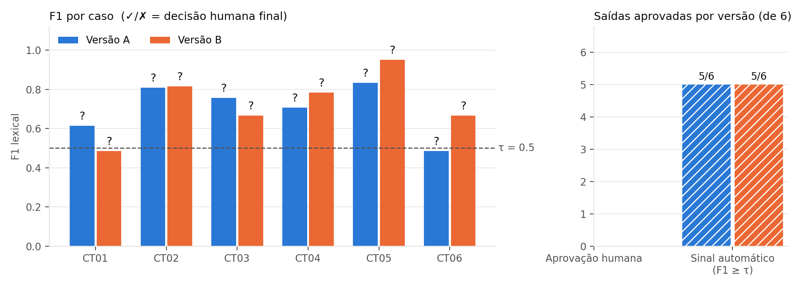

# Resultados consolidados

Gerado por `python -m atividade3.scripts.consolidar`. Estado: **12/12 saídas** (0 com erro), **12/12 notas R1**, **4/4 notas R2**, 0 consenso(s). τ = 0.5.

## Tabela das 12 saídas

| Caso | Versão | F1 | Sinal auto | Notas R1 | Notas R2 | Consenso | Decisão humana final | Auto = humano? | Justificativa |
|---|---|---|---|---|---|---|---|---|---|
| CT01 | A | 0.615 | aprova | C2 R2 S2 FC0 | C2 R2 S2 FC0 | — | sim (R1) | sim | 7,0 e frequência de 75% conforme Art. 2º com citação cobrindo ambas |
| CT01 | B | 0.485 | reprova | C1 R2 S2 FC0 | C1 R1 S2 FC0 | — | não (R1) | sim | Cita o Art. 2º com 7,0 correto mas omite a frequência mínima de 75% |
| CT02 | A | 0.808 | aprova | C2 R2 S2 FC0 | — | — | sim (R1) | sim | 5 dias úteis na coordenação conforme Art. 5º |
| CT02 | B | 0.816 | aprova | C2 R2 S2 FC0 | — | — | sim (R1) | sim | 5 dias úteis na coordenação conforme Art. 5º sem omissões |
| CT03 | A | 0.757 | aprova | C2 R2 S2 FC0 | — | — | sim (R1) | sim | 3 livros simultâneos e 7 dias corridos conforme DOC-BIBLIO |
| CT03 | B | 0.667 | aprova | C2 R2 S2 FC0 | — | — | sim (R1) | sim | 3 livros e 7 dias corridos conforme DOC-BIBLIO |
| CT04 | A | 0.706 | aprova | C1 R2 S2 FC0 | — | — | não (R1) | não | Informa o prazo da 8ª semana pelo portal mas omite que depois só por laudo de saúde |
| CT04 | B | 0.783 | aprova | C1 R2 S2 FC0 | — | — | não (R1) | não | Informa o prazo da 8ª semana pelo portal mas omite a exceção por laudo de saúde |
| CT05 | A | 0.833 | aprova | C2 R1 S2 FC0 | C1 R1 S2 FC0 | — | não (R1) | não | Abstenção correta sem inventar valor mas recusa sem orientar a coordenação |
| CT05 | B | 0.950 | aprova | C2 R2 S2 FC0 | C2 R2 S2 FC0 | — | sim (R1) | sim | Abstenção correta sem inventar valor e orienta procurar a coordenação |
| CT06 | A | 0.485 | reprova | C1 R2 S2 FC0 | — | — | não (R1) | sim | Cita 7,0 correto mas omite os 75% de frequência do Art. 2º |
| CT06 | B | 0.667 | aprova | C2 R2 S2 FC0 | — | — | sim (R1) | sim | 7,0 e 75% de frequência conforme Art. 2º |

Notas: C = correção, R = relevância, S = suporte (0–2), FC = falha crítica (0/1). Aprovação humana = C2 R2 S2 e FC0.

## Resumo por versão (denominador 6)

| Medida | Versão A | Versão B |
|---|---|---|
| F1 médio | 0.701 | 0.728 |
| F1 mediano | 0.732 | 0.725 |
| Sinal automático aprova (F1 ≥ τ) | 5/6 | 5/6 |
| **Aprovação humana** | 3/6 | 4/6 |
| Falhas críticas | 0/6 | 0/6 |

## Concordâncias

- **Auto–humano** (sinal F1 ≥ τ × decisão humana final): 9/12.
- **R1–R2** (decisão aprovado/reprovado, só nas 4 saídas revisadas, antes do consenso): 4/4; notas idênticas nas 4 dimensões em 2/4.
- *Avaliação adicional por LLM (não humana, não entra na decisão)* × decisão humana: 8/12.

### Saídas revisadas por R2

| Caso | Versão | R1 | R2 | Consenso |
|---|---|---|---|---|
| CT01 | A | C2 R2 S2 FC0 | C2 R2 S2 FC0 | — |
| CT01 | B | C1 R2 S2 FC0 | C1 R1 S2 FC0 | — |
| CT05 | A | C2 R1 S2 FC0 | C1 R1 S2 FC0 | — |
| CT05 | B | C2 R2 S2 FC0 | C2 R2 S2 FC0 | — |

## Divergências automático × humano

Saídas em que o sinal automático e a decisão humana discordam: CT04/A, CT04/B, CT05/A. A análise qualitativa está em `docs/analise_divergencia.md`.

## Decisão experimental (critério pré-registrado)

**levar B à próxima etapa** — aprovação humana B 4/6 > A 3/6, sem falha crítica. Não é autorização para produção.

